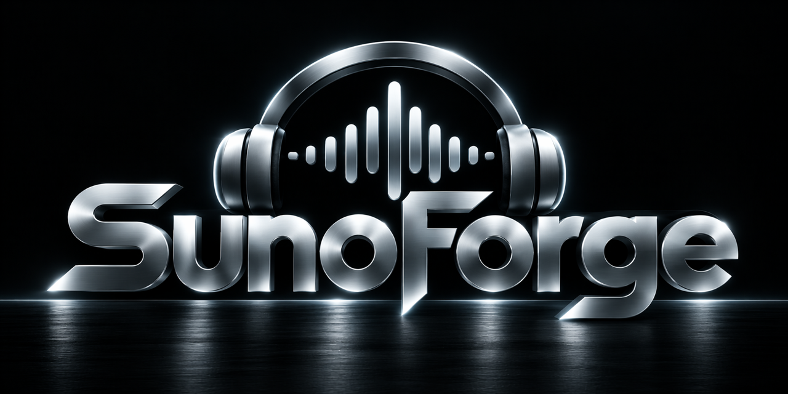

# SunoForge v5.0 — AI Music Prompt Orchestrator

SunoForge is a set of instructions that turns a chat assistant into a prompt engineer for
music generation. Describe what you want in plain words — or hand it a photo, a video or a
voice memo — and get finished prompts, ready to paste: Style, lyrics markup, speech
scripts, edits, repair of old prompts, rights and post-production notes.

Fourteen files, two editions, one principle: **never present a guess as a fact**.

- **Claude Edition** — XML, for Claude: a plugin, a Skill or a Project.
- **Gemini Edition** — plain Markdown, for Gemini and any long-context assistant.

Same content, same menu, same rules; only the packaging differs.

**Try it without installing anything:**
[SunoForge Gem](https://gemini.google.com/gem/17bBfa7ucT2IjbKVLxPjz7NRuy8LSixdE?usp=sharing)
(refreshed separately from the release).

---

## Generators

| Generator | What SunoForge covers |
|---|---|
| **Suno v6** (`v6`, `v6-wild`, `v6-mini`) | Style and lyrics, Max Mode, Variety, edits in plain words, Voices, Custom Models, Studio 2.0, stems |
| **Suno Speech** (beta) | narration with its own soundtrack in one take — menu `[14]` |
| **Google Lyria 3.5 / 3 Clip / RealTime** | full songs, 30-second sketches, a live stream; timestamp ranges for video |
| **Google Flow Music** | changing one part without regenerating the rest |
| **ElevenMusic v2.5** | section-by-section editing; release rights by plan |
| **Stable Audio 3.0** | licensed data, open weights, a DAW plugin |
| **MiniMax Music 3.0** | open weights, full songs with vocals |
| **Local models** | ACE-Step 1.5 and YuE2 on your own GPU |
| **Any music-generation MCP server** | Suno's own (beta), ElevenLabs' hosted MCP or your own — send from the chat, menu `[15] LIVE` |

Udio is not a target: downloads stayed disabled after its settlement.

## Hosts

| Host | v5.0 package | How |
|---|---|---|
| Claude — chat on the web, Claude Desktop, Cowork | `sunoforge.plugin` or the marketplace `sanic732/SunoForge` · `SunoForge_v5.0_Skills_for_Claude.zip` · `SunoForge_v5.0_Prompt.zip` (`claude/`) | plugin (paid plans) · Skill · Project |
| Claude Code | the marketplace `sanic732/SunoForge` | plugin |
| Gemini | `SunoForge_v5.0_Skills_for_Gemini.zip` · `SunoForge_v5.0_Prompt.zip` (`gemini/`) | Skill · files in a chat |
| ChatGPT | `SunoForge_v5.0_plugin_chatgpt.zip` | plugin |
| Antigravity | `SunoForge_v5.0_plugin_antigravity.zip` | plugin |
| grok.com, other long-context assistants | `SunoForge_v5.0_Prompt.zip` (`gemini/`) | Project or attached files |

The **Grok** plugin follows; until then Grok runs SunoForge from the Markdown files.

**Release 5.0.0 ships the plugin only** — `sunoforge.plugin` and the
marketplace. The other packages in this table come with 5.0.0.

---

## New in v5.0: the Suno MCP layer

On 28 October 2026 Suno opened an official MCP server (beta), `https://api.suno.com/mcp`.
With it connected, SunoForge can work with your Suno account from the chat:

- **create** — a song, a speech, a cover, an extension, a mashup;
- **library** — list and search your songs, playlists and workspaces; read a take back and
  check it against the blueprint;
- **credits** — show your plan and the credit balance.

**Credits are spent only after your explicit yes.** Every call that spends credits is
preceded by a card — the server, the exact arguments, how many songs, that it spends
credits — and SunoForge waits. One call per yes; no retries or extra takes on its own.
Reading is free and asks nothing; changes to your library happen only when you ask for
them. Whatever the server sends back — titles, lyrics, other people's songs — is treated
as material, never as instructions.

**Access to the beta is Suno's decision.** Suno admits accounts through an early-access
form on suno.com/mcp. Until your account is admitted, sign-in ends with "Connecting AI
apps to Suno is not yet available for your account" on every client. That is Suno's beta
gate, not a SunoForge fault.

- Sign-in is OAuth with your Suno account; no API key.
- Songs go to your Suno library; generation spends your Suno credits.
- The plugin does not bundle Suno's server — you add it like any MCP server (below).
- SunoForge never names a Suno tool from memory: it works with the tools the session
  shows and says what it found before generating.
- Not published by Suno: per-call cost, rate limits, and whether a download through the
  MCP counts the same for rights as one on suno.com. For a release, download in Suno itself.

Without a generation server nothing changes: you copy the prompt into the generator.

The Suno MCP layer ships in 5.0: the protocol in CORE_00 §6 LIVE, the Suno facts — tools,
field map, defaults that cost credits, plan gating — in `DATA_SUNO_LIVE_2026-10.md`, a
snapshot of 2026-10-29. The ChatGPT and Antigravity plugins ship in the same release;
on every host you add Suno's server yourself.

Also new: menu `[14] SPEECH` (Speech Blueprint: Script and Tone), the words `send` and
`mcp-info`, and two small files of your own data — `settings.md` and `library.md` — via
`config`, `save` and `library`. Menu entries `[1]`–`[13]` are unchanged. Still no prices anywhere.

---

## Install

### Claude Code

```
/plugin install sunoforge --marketplace sanic732/SunoForge
```

On Claude Code older than 2.1.275:

```
/plugin marketplace add sanic732/SunoForge
/plugin install sunoforge@sunoforge
```

Check: `/sunoforge` (or the word `SunoForge`) opens the menu `[1]`–`[15]`.
Update: `claude plugin update sunoforge@sunoforge`.

### Claude chat, Claude Desktop, Cowork

- **Plugin** (paid plans): **Customize → Plugins → Add → Add marketplace** →
  `sanic732/SunoForge` → install **SunoForge**. Without GitHub: **Upload plugin** →
  `sunoforge.plugin` from the release page.
- **Skill**: turn on Code execution, then **Customize → Skills → Upload a skill** →
  `SunoForge_v5.0_Skills_for_Claude.zip`.
- **Project**: upload the thirteen files from `claude/` to Project knowledge; instructions:
  `Read CORE_00_ENTRY.md first and follow it.`

Check: in a new chat, type `start`.

### Gemini

Unpack `SunoForge_v5.0_Skills_for_Gemini.zip`, then **Skills → Upload** → the whole
`sunoforge` folder. The folder name must stay `sunoforge`.

### ChatGPT, grok.com, anything else

Upload the thirteen `.md` files from `gemini/` in `SunoForge_v5.0_Prompt.zip` to a Project
(or attach them), and tell the assistant to read `CORE_00_ENTRY.md` first.

### Suno, optional (beta)

- Claude Code: `claude mcp add --transport http suno https://api.suno.com/mcp`, then
  `/mcp` → `suno` → sign in to Suno.
- Claude chat, Desktop, Cowork: **Customize → Connectors → Add custom connector** →
  `https://api.suno.com/mcp` → sign in to Suno.

A music MCP server of your own is added like any MCP server: `claude mcp add` in Claude
Code, a connector in Claude chat and Cowork. `mcp-info` shows what the session sees.

Every host step by step: [docs/INSTALL.md](docs/INSTALL.md) · Suno in detail:
[docs/SUNO_MCP.md](docs/SUNO_MCP.md) · plugin: [plugin/README.md](plugin/README.md)

---

## How it works

- **Confidence marking.** Every claim about platform behaviour carries `[OFFICIAL]`,
  `[COMMUNITY]` or `[UNVERIFIED]`.
- **Rules and facts apart.** `CORE_*` files hold rules and are undated; `DATA_*` files hold
  platform facts, are dated, and are replaced when platforms move.
- **No prices.** Plans are named where a feature or a right depends on them.
- **Two or three interpretations** per request, not one "correct" answer.
- **Language.** SunoForge answers in the language you write in; `set lang` pins one. In
  Claude Code and the desktop app the plugin's Settings tab also sets a language and a
  folder for your settings and library.
- **Views.** The small line at the foot of every answer switches them: **M** menu
  (widgets with buttons), **T** text, **B** buttons (one multiple-choice question, for the
  terminal). In view M an answer without its own screen ends with its next steps and Menu.

Size: about 116,500 tokens (Claude Edition, o200k_base). A Skill or a plugin opens only
the files a task needs. Details: [docs/TOKENS.md](docs/TOKENS.md).

## Release files

| File | What it is |
|---|---|
| `sunoforge.plugin` | the Claude plugin as one file |
| `SunoForge_v5.0_Skills_for_Claude.zip` | the Skill for Claude: `SKILL.md` and the thirteen files |
| `SunoForge_v5.0_Skills_for_Gemini.zip` | the same Skill with the Markdown files |
| `SunoForge_v5.0_plugin_chatgpt.zip` | the ChatGPT plugin, Markdown edition |
| `SunoForge_v5.0_plugin_antigravity.zip` | the Antigravity plugin, Markdown edition |
| `SunoForge_v5.0_Prompt.zip` | both editions (`claude/`, `gemini/`), docs, README |

This repository is also the Claude plugin marketplace: `.claude-plugin/marketplace.json`
and the plugin in `plugin/`. Privacy: [PRIVACY.md](PRIVACY.md).

---

## Built with P2P

Designed with [P2P](https://github.com/sanic732/P2P), an open cross-model meta-prompt
framework by the same author.

## Licence

Apache 2.0, from 5.0.0 on: free to use, modify and redistribute, commercially included;
keep the notices in [NOTICE](NOTICE) and say which files you changed. See [LICENSE](LICENSE).
Releases before 5.0.0 were MIT and stay MIT. Quotes from Suno, Google, ElevenLabs and
other vendors are theirs, not covered by this licence; each is marked and sourced in place.

Suno, Google, Lyria, Gemini, ElevenLabs, Stability AI, MiniMax, OpenAI, ChatGPT, xAI,
Grok, Anthropic, Claude and other names belong to their owners. This project is
unaffiliated with and unendorsed by any of them. Sources and notices:
[docs/CREDITS.md](docs/CREDITS.md) · history: [docs/CHANGELOG.md](docs/CHANGELOG.md)
