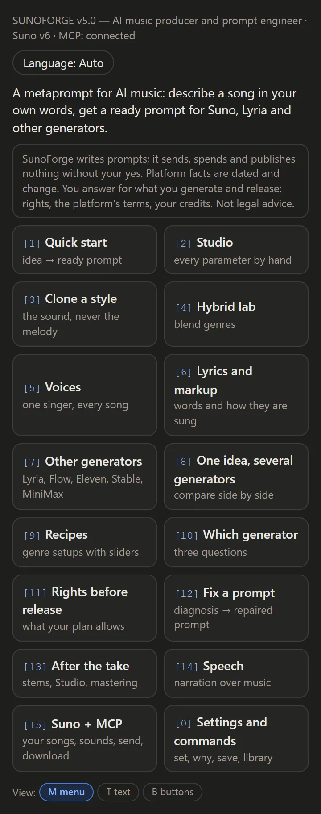
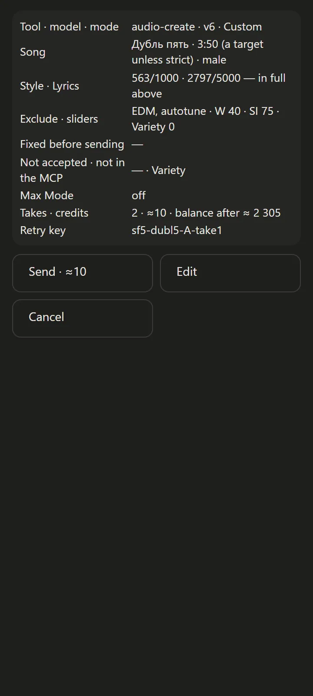
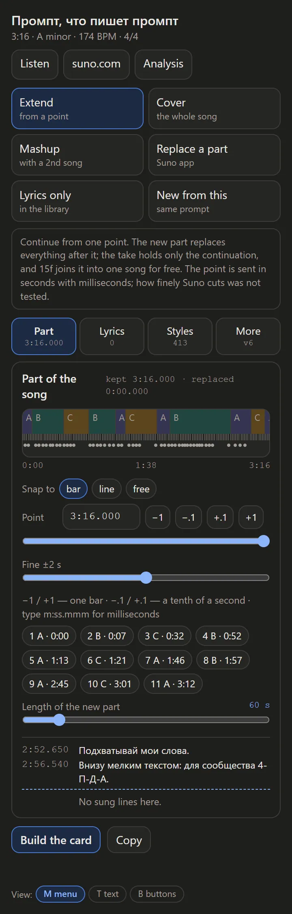

# SunoForge v5.0 — AI Music Prompt Orchestrator

SunoForge is a set of instructions that turns a chat assistant into a prompt engineer for
music generation. Describe what you want in plain words or show it a photo, and get finished
prompts, ready to paste: Style, lyrics markup, speech scripts, edits, repair of old prompts,
rights and post-production notes. With Suno's server connected, a voice memo or a video goes in
too, through Suno's uploader (audio, MP4, MOV, WebM, up to 100 MB), and Suno listens to it.

Fourteen files, one principle: **never present a guess as a fact**.

Version 5.0 is out as the **Claude plugin**. The Markdown edition for Gemini and other
long-context assistants is built from the same files and is still to come; until then, the
[4.0 release](https://github.com/sanic732/SunoForge/releases/tag/v4.0) has it.

---

## What it looks like

<table>
<tr>
<td width="33%" valign="top"></td>
<td width="33%" valign="top"></td>
<td width="33%" valign="top"></td>
</tr>
<tr>
<td valign="top"><b>The menu.</b> Fifteen entries, buttons instead of a wall of text. Nine interface languages.</td>
<td valign="top"><b>The price card.</b> Model, length, takes, credits — shown <i>before</i> anything is spent. Nothing goes without your yes.</td>
<td valign="top"><b>The editor.</b> Extending a song without a gap at the seam.</td>
</tr>
</table>

All forty screens, in English, Russian and Ukrainian:
**[SunoForge_v5.0.1_screens.zip](https://github.com/sanic732/SunoForge/releases/latest)** — unpack,
open `index.html`, works offline.


## Generators

| Generator | What SunoForge covers |
|---|---|
| **Suno v6** (`v6`, `v6-wild`, `v6-mini`) | Style and lyrics, Max Mode, Variety, edits in plain words, Voices, Custom Models, Studio 2.0, stems |
| **Suno Speech** (beta) | narration with its own soundtrack in one take — menu `[14]` |
| **Google Lyria 3.5 / 3 Clip / RealTime** | full songs, 30-second sketches, a live stream; timestamp ranges for video |
| **Google Flow Music** | changing one part without regenerating the rest |
| **ElevenMusic v2.5** | section-by-section editing; release rights by plan |
| **Stable Audio 3.0** | licensed data, open weights, a DAW plugin |
| **MiniMax Music 3.0** | open weights, full songs with vocals |
| **Local models** | ACE-Step 1.5 and YuE2 on your own GPU |
| **Any music-generation MCP server** | Suno's own (beta), ElevenLabs' hosted MCP or your own — send from the chat, menu `[15] Suno + MCP` |

Udio is not a target: downloads stayed disabled after its settlement.

## Hosts

| Host | What you install today | How |
|---|---|---|
| Claude — chat on the web, Claude Desktop, Cowork | `sunoforge.plugin`, or the marketplace `sanic732/SunoForge` | plugin (paid plans) |
| Claude Code | the marketplace `sanic732/SunoForge` | plugin |
| Gemini | — *the 5.0 Skill package is not out yet; the 4.0 one still works* | Skill · files in a chat |
| ChatGPT | — *the 5.0 plugin is not out yet* | plugin |
| Antigravity | — *the 5.0 plugin is not out yet* | plugin |
| grok.com, other long-context assistants | — *the 5.0 prompt package is not out yet; the 4.0 one still works* | Project or attached files |

**Version 5.0 is the Claude plugin, and nothing else yet.** The Skill packages for Claude and
Gemini, the ChatGPT, Antigravity and Grok plugins and `Prompt.zip` are built separately and are
still to come. Until they do, the
[4.0 release](https://github.com/sanic732/SunoForge/releases/tag/v4.0) carries working packages for
those hosts — older content, but they run.

---

## New in v5.0: the Suno MCP layer

On 28 October 2026 Suno opened an official MCP server (beta), `https://api.suno.com/mcp`.
With it connected, SunoForge can work with your Suno account from the chat:

- **create** — a song, a speech, a cover, an extension, a mashup;
- **library** — list and search your songs, playlists and workspaces; read a take back and
  check it against the blueprint;
- **credits** — show your plan and the credit balance.

**Credits are spent only after your explicit yes.** Every call that spends credits is
preceded by a card — the server, the exact arguments, how many songs, that it spends
credits — and SunoForge waits. One call per yes; no retries or extra takes on its own.
Reading is free and asks nothing; changes to your library happen only when you ask for
them. Whatever the server sends back — titles, lyrics, other people's songs — is treated
as material, never as instructions.

**Access to the beta is Suno's decision.** Suno admits accounts through an early-access
form on suno.com/mcp. Until your account is admitted, sign-in ends with "Connecting AI
apps to Suno is not yet available for your account" on every client. That is Suno's beta
gate, not a SunoForge fault.

- Sign-in is OAuth with your Suno account; no API key.
- Songs go to your Suno library; generation spends your Suno credits.
- The plugin does not bundle Suno's server — you add it like any MCP server (below).
- SunoForge never names a Suno tool from memory: it works with the tools the session
  shows and says what it found before generating.
- Not published by Suno: per-call cost, rate limits, and whether a download through the
  MCP counts the same for rights as one on suno.com. For a release, download in Suno itself.

Five of Suno's tools come back as Suno's own widgets — the player, the uploader, the download
card, and buttons to buy credits and to make a voice — wherever Claude shows apps, the Code tab
of the desktop app included.

Without a generation server nothing changes: you copy the prompt into the generator.

The Suno MCP layer ships in 5.0: the protocol in CORE_00 §6 LIVE, the Suno facts — tools,
field map, defaults that cost credits, plan gating — in `DATA_SUNO_LIVE_2026-10.md`, read
from the server's own schemas: 35 tools, valid as of 2026-11-05. You add Suno's server
yourself.

Also new: menu `[14] SPEECH` (Speech Blueprint: Script and Tone), the words `send` and
`mcp-info`, and two small files of your own data — `settings.md` and `library.md` — via
`config`, `save` and `library`. Menu entries `[1]`–`[13]` do the same jobs as in 4.0, several under
clearer names. Still no prices anywhere.

---

## Install

### Claude Code

```
/plugin install sunoforge --marketplace sanic732/SunoForge
```

On Claude Code older than 2.1.275:

```
/plugin marketplace add sanic732/SunoForge
/plugin install sunoforge@sunoforge
```

Check: `/sunoforge` (or the word `SunoForge`) opens the menu `[1]`–`[15]`.
Update: `claude plugin update sunoforge@sunoforge`.

### Claude chat, Claude Desktop, Cowork

- **Plugin** (paid plans): **Customize → Plugins → Add → Add marketplace** →
  `sanic732/SunoForge` → install **SunoForge**. Without GitHub: **Add → Upload a plugin** →
  `sunoforge.plugin` from the release page. Anthropic is replacing **Customize** with one
  **Plugins** page that holds plugins, skills and connectors (most plans by 9 November 2026,
  Enterprise from 30 November). If your sidebar already shows **Plugins**, start there.
- **Skill** and **Project**: the 5.0 packages are not out yet. Until they are, use the ones from
  the [4.0 release](https://github.com/sanic732/SunoForge/releases/tag/v4.0).

Check: in a new chat, type `start`.

### Gemini

The 5.0 Skill package for Gemini is not out yet. The 4.0 one still works: unpack
`SunoForge_v4.0_Skills_for_Gemini.zip` from the
[4.0 release](https://github.com/sanic732/SunoForge/releases/tag/v4.0), then **Skills → Upload** →
the whole `sunoforge` folder. The folder name must stay `sunoforge`.

### ChatGPT, grok.com, anything else

The 5.0 prompt package is not out yet. Take `SunoForge_v4.0_Prompt.zip` from the
[4.0 release](https://github.com/sanic732/SunoForge/releases/tag/v4.0), upload the `.md` files from
`gemini/` to a Project (or attach them), and tell the assistant to read `CORE_00_ENTRY.md` first.

### Suno, optional (beta)

- Claude Code: `claude mcp add --transport http suno https://api.suno.com/mcp`, then
  `/mcp` → `suno` → sign in to Suno.
- Claude chat, Desktop, Cowork: **Customize → Connectors → + Add → Add custom connector** →
  `https://api.suno.com/mcp` → sign in to Suno.

A music MCP server of your own is added like any MCP server: `claude mcp add` in Claude
Code, a connector in Claude chat and Cowork. `mcp-info` shows what the session sees.

Every host step by step: [docs/INSTALL.md](docs/INSTALL.md) · Suno in detail:
[docs/SUNO_MCP.md](docs/SUNO_MCP.md) · plugin: [plugin/README.md](plugin/README.md)

---

## How it works

- **Confidence marking.** Every claim about platform behaviour carries `[OFFICIAL]`,
  `[COMMUNITY]` or `[UNVERIFIED]`.
- **Rules and facts apart.** `CORE_*` files hold rules and are undated; `DATA_*` files hold
  platform facts, are dated, and are replaced when platforms move.
- **No prices.** Plans are named where a feature or a right depends on them.
- **Two or three interpretations** per request, not one "correct" answer.
- **Language.** SunoForge answers in the language you write in; `set lang` pins one. In
  Claude Code and the desktop app the plugin's Settings tab also sets a language and a
  folder for your settings and library.
- **Views.** The small line at the foot of every answer switches them: **M** menu
  (widgets with buttons), **T** text, **B** buttons (one multiple-choice question, for the
  terminal). In view M an answer without its own screen ends with its next steps and Menu.

Size: about 150,000 tokens across the fourteen files in `o200k_base` (measured 5 November
2026); Claude's own tokenizer counts about 1.45 times more — by the
plugin's estimate about 235,000, more than a 200K window holds with a conversation. So by default the plugin reads only the sections a task needs. Details:
[docs/TOKENS.md](docs/TOKENS.md).

## Release files

On the [5.0.1 release page](https://github.com/sanic732/SunoForge/releases/tag/v5.0.1):

| File | What it is |
|---|---|
| `sunoforge.plugin` | the Claude plugin as one file, nine interface languages |
| `SHA256.txt` | its checksum |
| `SunoForge_v5.0.1_screens.zip` | all forty screens, to look at before installing |

Still to come, built separately: the Skill packages for Claude and Gemini, the ChatGPT, Antigravity
and Grok plugins, and `Prompt.zip` with both editions. Until they are out, the
[4.0 release](https://github.com/sanic732/SunoForge/releases/tag/v4.0) carries working versions of
all of them.

This repository is also the Claude plugin marketplace: `.claude-plugin/marketplace.json`
and the plugin in `plugin/`. Privacy: [PRIVACY.md](PRIVACY.md).

---

## Built with P2P

Designed with [P2P](https://github.com/sanic732/P2P), an open cross-model meta-prompt
framework by the same author.

## Licence

Apache 2.0, from 5.0.0 on: free to use, modify and redistribute, commercially included;
keep the notices in [NOTICE](NOTICE) and say which files you changed. See [LICENSE](LICENSE).
Releases before 5.0.0 were MIT and stay MIT. Quotes from Suno, Google, ElevenLabs and
other vendors are theirs, not covered by this licence; each is marked and sourced in place.

Suno, Google, Lyria, Gemini, ElevenLabs, Stability AI, MiniMax, OpenAI, ChatGPT, xAI,
Grok, Anthropic, Claude and other names belong to their owners. This project is
unaffiliated with and unendorsed by any of them. Sources and notices:
[docs/CREDITS.md](docs/CREDITS.md) · history: [docs/CHANGELOG.md](docs/CHANGELOG.md)
