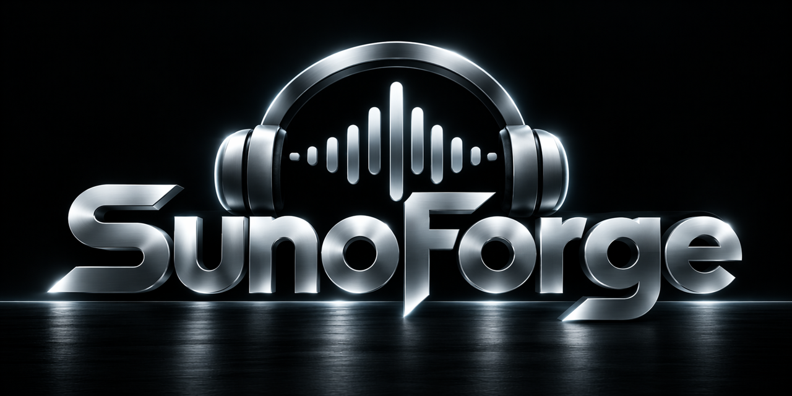
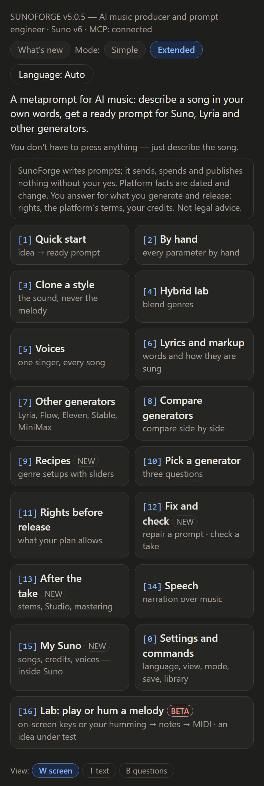
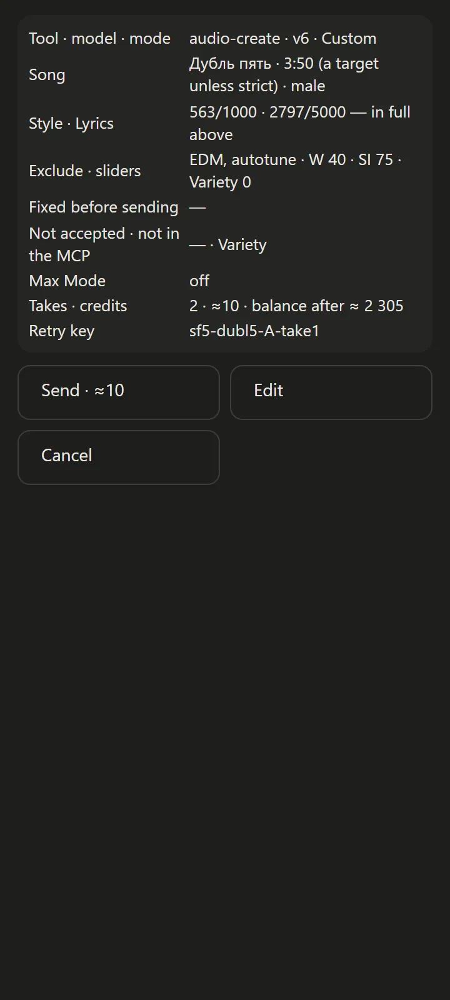
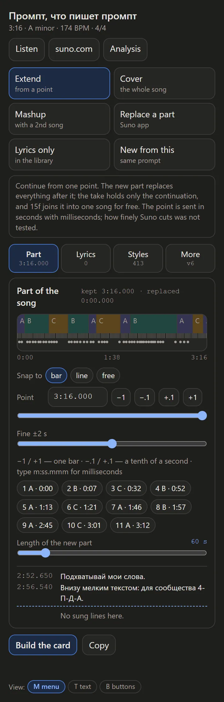

# SunoForge v5.0 — AI Music Prompt Orchestrator

SunoForge is a metaprompt for making music. It is an intermediate prompt, not the final one: the assistant
reads it and writes the final prompt for *your* song — Style, lyrics markup, a speech script, an edit, the
repair of an old prompt. It is built the same way as [P2P](https://github.com/sanic732/P2P).

At heart it is a reference: genres, instruments, voices, techniques and how they combine. It has no
hard-wired routes — the assistant opens the pages it needs and offers options in the words you use.

People use it in two ways:

- **You are not a musician** — describe the song in plain words or show a photo, and get a ready prompt.
- **You are a musician** — set everything exactly: genre, tempo, key, sliders, notes.

The menu is a remote for that reference: for those who want exact control, and for those who would rather
tap than read files. It carries hints, so after going through the settings once you can say the same in one
phrase the next time. Without the menu everything works the same — just say what you need.

**SunoForge itself connects nothing and generates nothing.** If you have added Suno's official MCP server to
your assistant yourself, the assistant can send the finished prompt there and work with your songs; before
anything is spent it shows a card with the price and waits for your yes. A voice memo or a video can go in
too, through Suno's uploader (audio, MP4, MOV, WebM, up to 100 MB), and Suno listens to it.

Fourteen files, one principle: **never present a guess as a fact**.

Version 5.0.5 is out as the **Claude plugin**, a **Gemini skill** and a **ChatGPT plugin**. The prompt packages for other
long-context assistants are built from the same files and are still to come; until then, the
[4.0 release](https://github.com/sanic732/SunoForge/releases/tag/v4.0) has them.

---

## What it looks like

<table>
<tr>
<td width="33%" valign="top"></td>
<td width="33%" valign="top"></td>
<td width="33%" valign="top"></td>
</tr>
<tr>
<td valign="top"><b>The menu.</b> Sixteen entries, buttons instead of a wall of text. Ready in English, Russian and Ukrainian; any other language is translated as the screen is drawn.</td>
<td valign="top"><b>The price card.</b> Model, length, takes, credits — shown <i>before</i> anything is spent. Nothing goes without your yes.</td>
<td valign="top"><b>The editor.</b> Extending a song without a gap at the seam.</td>
</tr>
</table>

Screenshots: [assets/screens](assets/screens).


## Generators

| Generator | What SunoForge covers |
|---|---|
| **Suno v6** (`v6`, `v6-wild`, `v6-mini`) | Style and lyrics, Max Mode, Variety, edits in plain words, Voices, Custom Models, Studio 2.0, stems |
| **Suno Speech** (beta) | narration with its own soundtrack in one take — menu `[14]` |
| **Google Lyria 3.5 / 3 Clip / RealTime** | full songs, 30-second sketches, a live stream; timestamp ranges for video |
| **Google Flow Music** | changing one part without regenerating the rest |
| **ElevenMusic v2.5** | section-by-section editing; release rights by plan |
| **Stable Audio 3.0** | licensed data, open weights, a DAW plugin |
| **MiniMax Music 3.0** | open weights, full songs with vocals |
| **Local models** | ACE-Step 1.5 and YuE2 on your own GPU |
| **Any music-generation MCP server** | Suno's own (beta), ElevenLabs' hosted MCP or your own — send from the chat, menu `[15] My Suno` |

Udio is not a target: downloads stayed disabled after its settlement.

## Hosts

| Host | What you install today | How |
|---|---|---|
| Claude — chat on the web, Claude Desktop, Cowork | `sunoforge.plugin`, or the marketplace `sanic732/SunoForge` | plugin (paid plans) |
| Claude Code | the marketplace `sanic732/SunoForge` | plugin |
| Gemini | `SunoForge_v5.0.5_Skill_for_Gemini.zip` | skill, uploaded from the archive; call it with `@Suno @sunoforge` |
| ChatGPT | `SunoForge_v5.0.5_Plugin_for_ChatGPT.zip` | plugin from an archive; Suno as a plugin of its own; call it with `@SunoForge` |
| Antigravity | — *the 5.0 plugin is not out yet* | plugin |
| Gemini notebooks, NotebookLM, grok.com, any chat that takes files | `SunoForge_v5.0.5_Prompt_RAG.zip` | Prompt with RAG markup (file edition): Markdown files as a notebook's sources, in a Project or attached |

**Version 5.0.5 is the Claude plugin, the Gemini skill, the ChatGPT plugin and the prompt with RAG markup (file edition).** The Skill package for
Claude and the Antigravity and Grok plugins are built separately and are still to come. Until they do, the
[4.0 release](https://github.com/sanic732/SunoForge/releases/tag/v4.0) carries working packages for
those hosts — older content, but they run.

---

## New in v5.0: the Suno MCP layer

On 28 October 2026 Suno opened an official MCP server (beta), `https://api.suno.com/mcp`.
With it connected, SunoForge can work with your Suno account from the chat:

- **create** — a song, a speech, a cover, an extension, a mashup;
- **library** — list and search your songs, playlists and workspaces; read a take back and
  check it against the blueprint;
- **credits** — show your plan and the credit balance.

**Credits are spent only after your explicit yes.** Every call that spends credits is
preceded by a card — the server, the exact arguments, how many songs, that it spends
credits — and SunoForge waits. One call per yes; no retries or extra takes on its own.
Reading is free and asks nothing; changes to your library happen only when you ask for
them. Whatever the server sends back — titles, lyrics, other people's songs — is treated
as material, never as instructions.

**Access to the beta is Suno's decision.** Suno admits accounts through an early-access
form on suno.com/mcp. Until your account is admitted, sign-in ends with "Connecting AI
apps to Suno is not yet available for your account" on every client. That is Suno's beta
gate, not a SunoForge fault.

- Sign-in is OAuth with your Suno account; no API key.
- Songs go to your Suno library; generation spends your Suno credits.
- The plugin does not bundle Suno's server — you add it like any MCP server (below).
- SunoForge never names a Suno tool from memory: it works with the tools the session
  shows and says what it found before generating.
- Not published by Suno: per-call cost, rate limits, and whether a download through the
  MCP counts the same for rights as one on suno.com. For a release, download in Suno itself.

Five of Suno's tools come back as Suno's own widgets — the player, the uploader, the download
card, and buttons to buy credits and to make a voice — wherever Claude shows apps, the Code tab
of the desktop app included.

**An inventory of Suno's server.** Suno publishes no full list of its server's tools and changes it without
notice. We keep our own inventory, one row per tool: what it does, what it costs, what it returns, its trap,
how it was checked. It is first-hand use on a live account, some paid calls made on the author's own credits;
what comes from the server's own descriptions is marked. On 20 November 2026 the server showed 59 tools: the
41 song tools are in the reference (`DATA_SUNO_LIVE_2026-10.md` §10), the 18 image and video tools in
[docs/SUNO_MCP_VISUALS.md](docs/SUNO_MCP_VISUALS.md).

Without a generation server nothing changes: you copy the prompt into the generator.

The Suno MCP layer ships in 5.0: the protocol in CORE_00 §6 LIVE, the Suno facts — tools,
field map, defaults that cost credits, plan gating — in `DATA_SUNO_LIVE_2026-10.md`, read
from the server's own schemas: 35 tools, valid as of 2026-11-05. You add Suno's server
yourself.

Also new: menu `[14] SPEECH` (Speech Blueprint: Script and Tone), the words `send` and
`mcp-info`, and two small files of your own data — `settings.md` and `library.md` — via
`config`, `save` and `library`. Menu entries `[1]`–`[13]` do the same jobs as in 4.0, several under
clearer names. Still no prices anywhere.

## Lab (beta)

A proof of concept, visible in the menu as **Lab** with a BETA tag. What it does today:

- **keys** — play a melody on the on-screen piano; it is recorded with note lengths and rests,
  turned into notes and then into a MIDI file you can give Suno as your melody;
- **humming** — sing or hum into an audio file and get notes from it; for now this is rough
  and often inexact.

Under the hood: the keys screen plays the notes in your browser, and two Python scripts in the
plugin (`scripts/notes2mid.py`, `scripts/audio2notes.py`) turn notes into a .mid and an audio file
into notes. They run on your machine, only when you ask and only where the session has a shell;
no network. They need Python 3 and numpy; `audio2notes.py` calls your own `ffmpeg`, if installed,
to read a file that is not WAV. The Gemini skill and the ChatGPT plugin have the two scripts
without the keys, as a trial — entry [16] of their menu.

Its stability is not confirmed, and what happens next depends on your feedback: it gets
developed, changed or removed. Tell me what helped and what is missing — for example,
connecting your own synth or MIDI keyboard — in the
[4PDA forum thread](https://4pda.to/forum/index.php?showtopic=1109539) or in this
repository's [Issues](../../issues).

---

## Install

### Claude Code

```
/plugin install sunoforge --marketplace sanic732/SunoForge
```

On Claude Code older than 2.1.275:

```
/plugin marketplace add sanic732/SunoForge
/plugin install sunoforge@sunoforge
```

Check: `/sunoforge` (or the word `SunoForge`) opens the menu `[1]`–`[16]`.
Update: `claude plugin update sunoforge@sunoforge`.

### Claude chat, Claude Desktop, Cowork

- **Plugin** (paid plans): **Customize → Plugins → Add → Add marketplace** →
  `sanic732/SunoForge` → install **SunoForge**. Without GitHub: **Add → Upload a plugin** →
  `sunoforge.plugin` from the release page. Anthropic is replacing **Customize** with one
  **Plugins** page that holds plugins, skills and connectors (most plans by 9 November 2026,
  Enterprise from 30 November). If your sidebar already shows **Plugins**, start there.
- **Skill** and **Project**: the 5.0 packages are not out yet. Until they are, use the ones from
  the [4.0 release](https://github.com/sanic732/SunoForge/releases/tag/v4.0).

Check: in a new chat, type `start`.

### Gemini

The 5.0.5 skill: unpack `SunoForge_v5.0.5_Skill_for_Gemini.zip` from the release page, then **Skills → Upload** →
the whole `sunoforge` folder. The folder name must stay `sunoforge`. Install it from the archive on every
account: a skill passed on through Gemini's "Share" link stopped working when we tried it (20 November 2026).

An older SunoForge skill (4.0, 5.0) installed? Delete it first — they share the name.

Suno in Gemini: add it once — `gemini.google.com/customize/connectors` (**Customize → Connectors**) → **+** →
`https://api.suno.com/mcp` → **Create**, then **Connect** and sign in to Suno. On 20 November 2026 the **+** button was there only with
the browser's language set to English and a connection from the US. Then call both in
each chat: `@Suno @sunoforge` and your words. A skill cannot attach a connector by itself: without
`@Suno` in the message SunoForge only writes prompts, and its menu shows `MCP: off — add @Suno`.

### ChatGPT

The 5.0.5 plugin — `SunoForge_v5.0.5_Plugin_for_ChatGPT.zip` from the release page. Done this way in the ChatGPT app on 20 November 2026:

1. ChatGPT → **Plugins** in the left sidebar → **Add** → **Upload plugin archive** → choose the zip. The SunoForge page
   opens: install the plugin.
2. Suno, optional — the same **Add** menu → **Add custom MCP server**: name `Suno`, server URL `https://api.suno.com/mcp`, leave the rest
   as it is, tick **I understand and want to continue**, then **Create as a plugin**. Connect Suno and sign in with
   your Suno account. Created as a plugin, Suno sits next to SunoForge and the two work together; added as a bare MCP
   server it did not work with SunoForge.
3. A new chat: `@SunoForge` and your words — `@Suno @SunoForge` with Suno. The word `SunoForge` opens the menu. If the
   first answer says SunoForge has no tools, send `@SunoForge` once more.

The plugin carries no MCP server of its own, and writing prompts needs neither Suno nor MCP. An archive does not update
itself: upload the next version again. The phone app takes the plugin from the same account: the menu, [15] and
the song editor worked in the Android app on 20 November 2026; the skill shows there as `$sunoforge`.

### grok.com, anything else

**Prompt with RAG markup (file edition)** — `SunoForge_v5.0.5_Prompt_RAG.zip` from the release page: the same SunoForge as eighteen Markdown
files with retrieval markup (a YAML header on every file, an anchor on every heading, tags at the end), so that a
notebook which reads its sources in parts finds the right section. Unpack it and give the files to the assistant:
as the sources of a notebook (a Gemini notebook, NotebookLM), in a Project, or attached to a chat —
`_preloader.md` first where the order matters. Then type `SunoForge`. The files connect nothing: where the chat
shows the tools of a Suno server you added, SunoForge sends through them after your yes; elsewhere you paste the
prompt by hand. The Lab, entry `[16]`, needs a chat that can run code. Tried in a Gemini notebook on 21 November 2026; in NotebookLM and in a Project it has not been run yet.

### Suno, optional (beta)

- Claude Code: `claude mcp add --transport http suno https://api.suno.com/mcp`, then
  `/mcp` → `suno` → sign in to Suno.
- Claude chat, Desktop, Cowork: **Customize → Connectors → + Add → Add custom connector** →
  `https://api.suno.com/mcp` → sign in to Suno.
- Gemini: above, under Gemini.

A music MCP server of your own is added like any MCP server: `claude mcp add` in Claude
Code, a connector in Claude chat and Cowork. `mcp-info` shows what the session sees.

Every host step by step: [docs/INSTALL.md](docs/INSTALL.md) · Suno in detail:
[docs/SUNO_MCP.md](docs/SUNO_MCP.md) · plugin: [plugin/README.md](plugin/README.md)

---

## How it works

- **Confidence marking.** Every claim about platform behaviour carries `[OFFICIAL]`,
  `[COMMUNITY]` or `[UNVERIFIED]`.
- **Rules and facts apart.** `CORE_*` files hold rules and are undated; `DATA_*` files hold
  platform facts, are dated, and are replaced when platforms move.
- **No prices.** Plans are named where a feature or a right depends on them.
- **Two or three interpretations** per request, not one "correct" answer.
- **Language.** SunoForge answers in the language you write in; `set lang` pins one. In
  Claude Code and the desktop app the plugin's Settings tab also sets a language and a
  folder for your settings and library.
- **Views.** The small line at the foot of every answer switches them: **W** screens
  (widgets with buttons, ten of them), **T** text, **B** questions (one multiple-choice
  question, for the terminal). In view W an answer without its own screen ends with its next
  steps and Menu. Gemini has no screens: T and B only.
- **Self-check.** The word `self-check` («самодиагностика») checks the installed copy — the version, the
  route map, the Suno tools, where your settings live — calling nothing and spending nothing.

Size: about 165,000 tokens across the fourteen reference files in `o200k_base`; Claude's own tokenizer
counts about 1.45 times more — about 240,000 (measured 20 November 2026), more
than a 200K window holds with a conversation. So by default the plugin reads only the sections a task needs. Details:
[docs/TOKENS.md](docs/TOKENS.md).

## Release files

On the [5.0.5 release page](https://github.com/sanic732/SunoForge/releases/tag/v5.0.5):

| File | What it is |
|---|---|
| `sunoforge.plugin` | the Claude plugin as one file; screens ready in English, Russian and Ukrainian |
| `SunoForge_v5.0.5_Skill_for_Gemini.zip` | the same SunoForge as a Gemini skill: unpack, then Gemini → Skills → Upload the folder `sunoforge`; call it with `@Suno @sunoforge` |
| `SunoForge_v5.0.5_Plugin_for_ChatGPT.zip` | the same SunoForge as a ChatGPT plugin: ChatGPT → Plugins → Add → Upload plugin archive; Suno is added apart, as a plugin of its own; call it with `@SunoForge` |
| `SunoForge_v5.0.5_Prompt_RAG.zip` | Prompt with RAG markup (file edition): eighteen Markdown files for a Gemini notebook, NotebookLM, a Project or any chat that takes attachments; `_preloader.md` is read first |
| `SHA256.txt` | the checksums of the four files |

Still to come, built separately: the Skill package for Claude and the Antigravity
and Grok plugins. Until they are out, the
[4.0 release](https://github.com/sanic732/SunoForge/releases/tag/v4.0) carries working versions of
all of them.

This repository is also the Claude plugin marketplace: `.claude-plugin/marketplace.json`
and the plugin in `plugin/`. The folder `catalog/` is the text edition of the same plugin for Claude's plugin
directory: Markdown files only, menus as text, no screens and no Lab. Privacy: [PRIVACY.md](PRIVACY.md).

---

## Built with P2P

Designed with [P2P](https://github.com/sanic732/P2P), an open cross-model meta-prompt
framework by the same author.

## Licence

Apache 2.0, from 5.0.0 on: free to use, modify and redistribute, commercially included;
keep the notices in [NOTICE](NOTICE) and say which files you changed. See [LICENSE](LICENSE).
Releases before 5.0.0 were MIT and stay MIT. Quotes from Suno, Google, ElevenLabs and
other vendors are theirs, not covered by this licence; each is marked and sourced in place.

Suno, Google, Lyria, Gemini, ElevenLabs, Stability AI, MiniMax, OpenAI, ChatGPT, xAI,
Grok, Anthropic, Claude and other names belong to their owners. This project is
unaffiliated with and unendorsed by any of them. Sources and notices:
[docs/CREDITS.md](docs/CREDITS.md) · history: [docs/CHANGELOG.md](docs/CHANGELOG.md)
