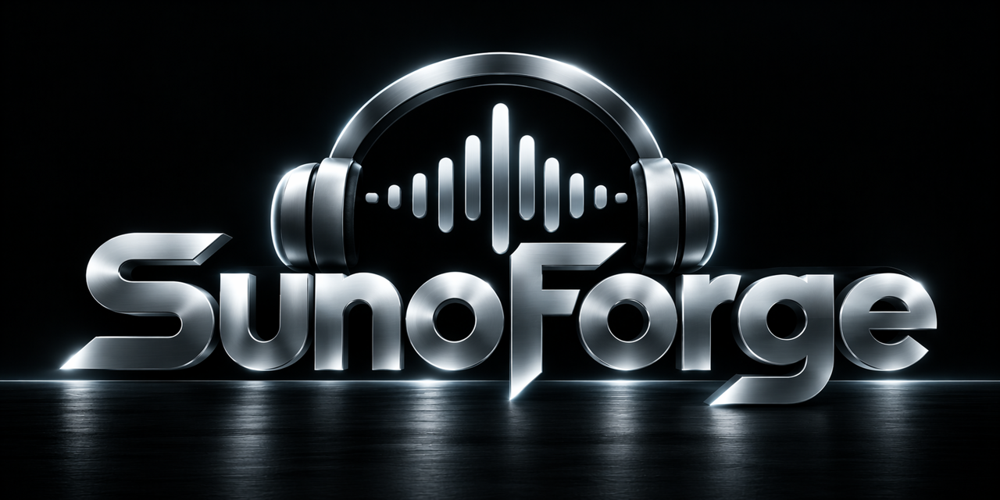
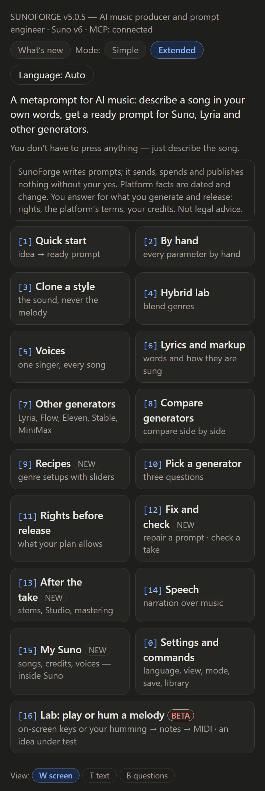
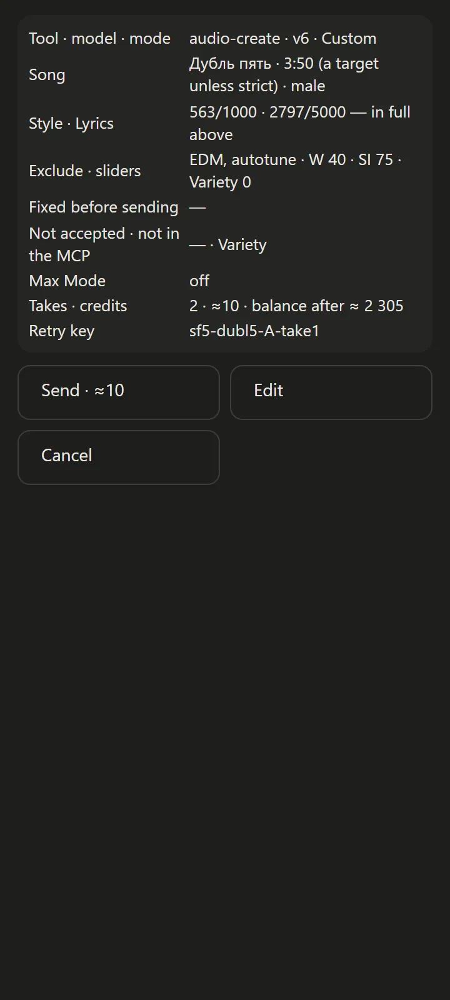
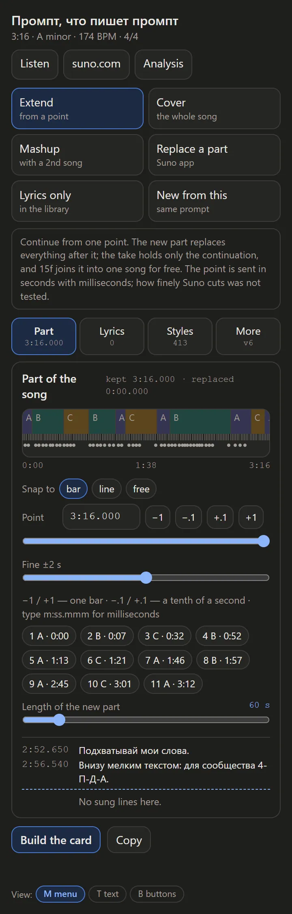

# SunoForge v5.0 — оркестратор промптов для AI-музыки

`[RU]` этот файл · `[EN]` [README.md](README.md)

SunoForge — метапромпт для создания музыки. Это промежуточный промпт, а не конечный: ассистент читает
его и пишет конечный промпт для *вашей* песни — Style, разметку текста, сценарий речи, правку, починку
старого промпта. Устроен так же, как [P2P](https://github.com/sanic732/P2P).

По сути это справочник: жанры, инструменты, голоса, приёмы и то, как их сочетать. Жёстких маршрутов в
нём нет — ассистент открывает нужные страницы и предлагает варианты теми словами, которыми говорите вы.

Им пользуются двумя способами:

- **Вы не музыкант** — опишите песню своими словами или покажите фото и получите готовый промпт.
- **Вы музыкант** — задаёте всё точно: жанр, темп, тональность, ползунки, ноты.

Меню — пульт к этому справочнику: для тех, кому нужен контроль, и для тех, кому проще нажать, чем
читать файлы. В нём есть подсказки: один раз пройдя по настройкам, в следующий раз вы скажете то же
одной фразой. Без меню всё работает так же — просто напишите, что нужно.

**Сам SunoForge ничего не подключает и ничего не генерирует.** Если вы сами добавили к ассистенту
официальный MCP-сервер Suno, ассистент может отправить готовый промпт туда и работать с вашими песнями;
перед любой тратой он показывает карточку с ценой и ждёт вашего «да». Голосовая заметка или видео тоже
идут в дело — через загрузчик Suno (аудио, MP4, MOV, WebM, до 100 МБ), и Suno их слушает.

Четырнадцать файлов, один принцип: **догадку не выдавать за факт**.

Версия 5.0.5 вышла как **плагин для Claude**, **навык для Gemini** и **плагин для ChatGPT**. Пакеты промпта для других
ассистентов с длинным контекстом собираются из тех же файлов и ещё впереди; пока их нет, работает
[релиз 4.0](https://github.com/sanic732/SunoForge/releases/tag/v4.0).

---

## Как это выглядит

<table>
<tr>
<td width="33%" valign="top"></td>
<td width="33%" valign="top"></td>
<td width="33%" valign="top"></td>
</tr>
<tr>
<td valign="top"><b>Меню.</b> Шестнадцать пунктов, кнопки вместо стены текста. Готово на английском, русском и украинском; любой другой язык переводится при отрисовке экрана.</td>
<td valign="top"><b>Карточка цены.</b> Модель, длина, дубли, кредиты — <i>до</i> того, как что-то потрачено. Без вашего «да» ничего не уходит.</td>
<td valign="top"><b>Редактор.</b> Продление песни без шва на стыке.</td>
</tr>
</table>

Скриншоты: [assets/screens](assets/screens).

## Генераторы

| Генератор | Что умеет SunoForge |
|---|---|
| **Suno v6** (`v6`, `v6-wild`, `v6-mini`) | Style и текст, Max Mode, Variety, правки словами, Voices, Custom Models, Studio 2.0, стемы |
| **Suno Speech** (beta) | речь со своей музыкой за один заход — пункт `[14]` |
| **Google Lyria 3.5 / 3 Clip / RealTime** | полные песни, 30-секундные наброски, живой поток; диапазоны таймкодов под видео |
| **Google Flow Music** | изменить одну часть, не перегенерируя остальное |
| **ElevenMusic v2.5** | правка по секциям; права на релиз по тарифу |
| **Stable Audio 3.0** | лицензированные данные, открытые веса, плагин для DAW |
| **MiniMax Music 3.0** | открытые веса, полные песни с вокалом |
| **Локальные модели** | ACE-Step 1.5 и YuE2 на своей видеокарте |
| **Любой MCP-сервер генерации музыки** | собственный Suno (beta), хостовый MCP ElevenLabs или ваш — отправка из чата, пункт `[15] My Suno` |

Udio — не целевая платформа: скачивание так и осталось закрыто после мирового соглашения.

## Где работает

| Ассистент | Что ставить сегодня | Как |
|---|---|---|
| Claude — чат на сайте, Claude Desktop, Cowork | `sunoforge.plugin` или маркетплейс `sanic732/SunoForge` | плагин (платные тарифы) |
| Claude Code | маркетплейс `sanic732/SunoForge` | плагин |
| Gemini | `SunoForge_v5.0.5_Skill_for_Gemini.zip` | навык, загружается из архива; вызов — `@Suno @sunoforge` |
| ChatGPT | `SunoForge_v5.0.5_Plugin_for_ChatGPT.zip` | плагин из архива; Suno — отдельным плагином; вызов — `@SunoForge` |
| Antigravity | — *плагина 5.0 ещё нет* | плагин |
| Блокноты Gemini, NotebookLM, grok.com, любой чат с вложениями | `SunoForge_v5.0.5_Prompt_RAG.zip` | Промпт с RAG-разметкой (файловая версия): Markdown-файлы источниками блокнота, в Project или вложением |

**Версия 5.0.5 — это плагин для Claude, навык для Gemini, плагин для ChatGPT и промпт с RAG-разметкой (файловая версия).** Навык (Skill) для
Claude и плагины для Antigravity и Grok собираются отдельно и ещё впереди. Пока их нет,
[релиз 4.0](https://github.com/sanic732/SunoForge/releases/tag/v4.0) содержит рабочие пакеты для
этих ассистентов — содержание старее, но они работают.

---

## Слой Suno MCP

28 октября 2026 года Suno открыл официальный MCP-сервер (beta), `https://api.suno.com/mcp`.
С ним SunoForge работает с вашим аккаунтом Suno прямо из чата:

- **создание** — песня, речь, кавер, продление, мэшап, звуки, новая песня из ваших песен;
- **правка** — замена части песни, слова строки, инструмент; стемы, MIDI, публикация;
- **библиотека** — ваши песни, поиск, лайки, плейлисты и воркспейсы; проверка дубля по замыслу;
- **кредиты** — тариф и остаток.

**Кредиты тратятся только после вашего явного «да».** Перед каждым вызовом, который тратит кредиты,
SunoForge показывает карточку — сервер, точные аргументы, сколько песен, что это стоит — и ждёт. Один
вызов на одно «да»; никаких повторов и лишних дублей по своей инициативе. Чтение бесплатно и ничего
не спрашивает; изменения в вашей библиотеке — только когда вы просите. Всё, что присылает сервер, —
названия, тексты, чужие песни, — считается материалом, а не инструкцией.

**Доступ к beta решает Suno.** Suno допускает аккаунты через форму раннего доступа на suno.com/mcp.
Пока аккаунт не допущен, вход на любом клиенте заканчивается сообщением «Connecting AI apps to Suno
is not yet available for your account». Это ограничение Suno, а не ошибка SunoForge.

- Вход — OAuth через аккаунт Suno, без API-ключа.
- Песни ложатся в вашу библиотеку Suno, генерация тратит ваши кредиты.
- Плагин не включает сервер Suno — вы добавляете его сами, как любой MCP-сервер (ниже).
- SunoForge не называет инструменты Suno по памяти: работает с теми, что показывает сессия, и
  говорит, что нашёл, до генерации.
- Suno не публикует: цену каждого вызова, лимиты частоты и то, равно ли скачивание через MCP
  скачиванию на suno.com с точки зрения прав. Для релиза скачивайте в самом Suno.

Пять инструментов Suno возвращаются собственными виджетами Suno — плеер, загрузчик, карточка
скачивания, кнопки покупки кредитов и создания голоса — везде, где Claude показывает приложения,
включая вкладку Code в приложении для компьютера.

**Опись сервера Suno.** Suno нигде не публикует полный список инструментов своего сервера и меняет его
без объявлений. Мы ведём свою опись, по строке на инструмент: что делает, сколько стоит, что возвращает,
где ловушка и как проверено. Это собственный опыт на живом аккаунте, часть платных вызовов сделана за свои
кредиты; что взято из описаний самого сервера — помечено. На 20 ноября 2026 года сервер показывал
59 инструментов: 41 для песен — в справочнике (`DATA_SUNO_LIVE_2026-10.md` §10), 18 для картинок и видео —
в [docs/SUNO_MCP_VISUALS.md](docs/SUNO_MCP_VISUALS.md).

Без сервера генерации ничего не меняется: вы копируете промпт в генератор сами.

## Лаборатория (beta)

Проверка идеи — в меню она видна как **Лаборатория** с меткой BETA. Что умеет сейчас:

- **клавиши** — наиграй мелодию на экранном пианино; она записывается с длительностями и
  паузами, превращается в ноты, а из них — в MIDI-файл, который можно отдать Suno как свою мелодию;
- **напетое** — напой мелодию в аудиофайл и получи из него ноты; пока это грубо и часто неточно.

Как это устроено: экран клавиш играет ноты в браузере, а два Python-скрипта плагина
(`scripts/notes2mid.py`, `scripts/audio2notes.py`) превращают ноты в .mid и аудиофайл в ноты.
Работают на вашем компьютере, только по просьбе и только там, где у сессии есть shell; в сеть
не ходят. Нужны Python 3 и numpy; `audio2notes.py` вызывает ваш `ffmpeg`, если он установлен,
чтобы прочитать файл не в WAV. В навыке для Gemini и в плагине для ChatGPT — её два скрипта без клавиш, пробно: пункт [16] меню.

Стабильность не подтверждена, и что будет дальше, решают отзывы: развиваем, меняем или
убираем. Напишите, что пригодилось и чего не хватает — например, подключить свой синтезатор
или MIDI-клавиатуру, — в [обсуждении на форуме 4PDA](https://4pda.to/forum/index.php?showtopic=1109539)
или в [Issues](../../issues) репозитория.

---

## Установка

### Claude Code

```
/plugin install sunoforge --marketplace sanic732/SunoForge
```

В Claude Code старше 2.1.275:

```
/plugin marketplace add sanic732/SunoForge
/plugin install sunoforge@sunoforge
```

Проверка: `/sunoforge` (или слово `SunoForge`) открывает меню `[1]`–`[16]`.
Обновление: `claude plugin update sunoforge@sunoforge`.

### Чат Claude, Claude Desktop, Cowork

- **Плагин** (платные тарифы): **Customize → Plugins → Add → Add marketplace** →
  `sanic732/SunoForge` → установите **SunoForge**. Без GitHub: **Add → Upload a plugin** →
  `sunoforge.plugin` со страницы релиза. Anthropic заменяет **Customize** одной страницей
  **Plugins** — там плагины, навыки и коннекторы (на большинстве тарифов к 9 ноября 2026, Enterprise
  с 30 ноября). Если в боковой панели уже есть **Plugins**, начинайте оттуда.
- **Skill** и **Project**: пакетов 5.0 пока нет. До их выхода берите пакеты из
  [релиза 4.0](https://github.com/sanic732/SunoForge/releases/tag/v4.0).

Проверка: в новом чате напишите `start`.

### Gemini

Навык 5.0.5: распакуйте `SunoForge_v5.0.5_Skill_for_Gemini.zip` со страницы релиза и загрузите папку
`sunoforge` целиком: **Навыки → Загрузить**. Имя папки должно остаться `sunoforge`. Ставьте навык из архива
на каждом аккаунте: навык, переданный через «Поделиться» в Gemini, у нас перестал работать (проверено
20 ноября 2026).

Если стоит старый навык SunoForge (4.0, 5.0), сначала удалите его — имя у них одно.

Suno в Gemini: один раз добавьте его — страница `gemini.google.com/customize/connectors` (вкладка **Коннекторы**) →
кнопка **+** («Свое значение») → `https://api.suno.com/mcp` → **Подключить**, войдите в аккаунт Suno. На 20 ноября 2026 кнопка **+**
появлялась, только когда язык браузера Chrome английский, а подключение идёт из США.
Дальше в каждом чате вызывайте оба: `@Suno @sunoforge` и ваши слова. Сам навык коннектор не
подключает: без `@Suno` в сообщении SunoForge только пишет промпты, а в меню видно
`MCP: off — add @Suno`.

### ChatGPT

Плагин 5.0.5 — `SunoForge_v5.0.5_Plugin_for_ChatGPT.zip` со страницы релиза. Так он поставлен в приложении ChatGPT 20 ноября 2026:

1. ChatGPT → слева **Плагины** → **Добавить** → **Загрузить архив плагина** → выберите zip. Откроется страница
   SunoForge: установите плагин.
2. Suno, по желанию — в том же меню **Добавить** → **Добавить пользовательский сервер MCP**: название `Suno`, адрес
   `https://api.suno.com/mcp`, остальное не трогайте, отметьте **«Я понимаю и хочу продолжить»** и создайте его **в виде плагина**.
   Подключите Suno и войдите в свой аккаунт Suno. Созданный плагином, Suno стоит рядом с SunoForge, и они работают
   вместе; добавленный просто сервером MCP, с SunoForge он не заработал.
3. В новом чате: `@SunoForge` и ваши слова, с Suno — `@Suno @SunoForge`. Слово `SunoForge` открывает меню. Если в
   первом ответе сказано, что у SunoForge нет инструментов, отправьте `@SunoForge` ещё раз.

Своего сервера MCP в плагине нет, а для промптов не нужны ни Suno, ни MCP. Плагин из архива сам не обновляется:
новую версию загрузите так же. Приложение на телефоне берёт плагин из того же аккаунта: меню, [15] и редактор
песни работали в приложении для Android 20 ноября 2026; навык там виден как `$sunoforge`.

### grok.com и другие

**Промпт с RAG-разметкой (файловая версия)** — `SunoForge_v5.0.5_Prompt_RAG.zip` со страницы релиза: тот же SunoForge восемнадцатью
Markdown-файлами с разметкой для поиска (шапка YAML в каждом файле, якорь на каждом заголовке, теги в конце),
чтобы блокнот, который читает источники частями, находил нужный раздел. Распакуйте архив и отдайте файлы
ассистенту: источниками блокнота (блокнот Gemini, NotebookLM), в Project или вложением в чат — первым
`_preloader.md`, если порядок важен. Затем напишите `SunoForge`. Файлы ничего не подключают: если чат видит
инструменты сервера Suno, который вы добавили сами, SunoForge отправит через них после вашего «да»; иначе
промпт вставляется вручную. Лаборатории, пункт `[16]`, нужен чат, где выполняется код. Проверено в блокноте Gemini 21 ноября 2026; в NotebookLM и в Project пока не запускалось.

### Suno, по желанию (beta)

- Claude Code: `claude mcp add --transport http suno https://api.suno.com/mcp`, затем
  `/mcp` → `suno` → войдите в Suno.
- Чат Claude, Desktop, Cowork: **Customize → Connectors → + Add → Add custom connector** →
  `https://api.suno.com/mcp` → войдите в Suno.
- Gemini: выше, в разделе Gemini.

Свой MCP-сервер музыки добавляется как любой MCP-сервер: `claude mcp add` в Claude Code, коннектор
в чате Claude и Cowork. `mcp-info` показывает, что видит сессия.

Все ассистенты по шагам: [docs/INSTALL.md](docs/INSTALL.md) · Suno подробно:
[docs/SUNO_MCP.md](docs/SUNO_MCP.md) · плагин: [plugin/README.md](plugin/README.md)

---

## Как это работает

- **Маркировка достоверности.** Каждое утверждение о поведении платформы помечено:
  `[OFFICIAL]`, `[COMMUNITY]` или `[UNVERIFIED]`.
- **Правила и факты раздельно.** Файлы `CORE_*` — правила, без даты; файлы `DATA_*` — факты о
  платформах, с датой, и заменяются, когда платформы меняются.
- **Никаких цен.** Тарифы названы там, где от них зависит функция или право.
- **Две-три интерпретации** на запрос, а не один «правильный» ответ.
- **Язык.** SunoForge отвечает на том языке, на котором вы пишете; `set lang` закрепляет один. В
  Claude Code и приложении для компьютера вкладка Settings плагина задаёт ещё язык и папку для ваших
  настроек и библиотеки.
- **Вид.** Маленькая строка под каждым ответом переключает его: **W** экраны (виджеты с кнопками,
  их десять), **T** текст, **B** вопросы (один вопрос с вариантами — для терминала). В виде W ответ
  без своего экрана заканчивается следующими шагами и кнопкой «Меню». В Gemini экранов нет — только
  T и B.
- **Самопроверка.** Слово `самодиагностика` (`self-check`) сверяет установленную копию: версию, карту
  маршрутов, инструменты Suno, где хранятся настройки — ничего не вызывая и не тратя.

Размер: 14 справочных файлов — около 165 000 токенов в `o200k_base`; собственный токенизатор Claude
считает примерно в 1,45 раза больше — около 240 000 (замер 20 ноября 2026).
Это больше, чем окно в 200K вмещает вместе с разговором, поэтому по умолчанию плагин читает только
разделы, нужные задаче. Подробно: [docs/TOKENS.md](docs/TOKENS.md).

## Файлы релиза

На [странице релиза 5.0.5](https://github.com/sanic732/SunoForge/releases/tag/v5.0.5):

| Файл | Что это |
|---|---|
| `sunoforge.plugin` | плагин для Claude одним файлом; экраны готовы на английском, русском и украинском |
| `SunoForge_v5.0.5_Skill_for_Gemini.zip` | тот же SunoForge навыком для Gemini: распакуйте, затем Gemini → Навыки → Загрузить папку `sunoforge`; вызов — `@Suno @sunoforge` |
| `SunoForge_v5.0.5_Plugin_for_ChatGPT.zip` | тот же SunoForge плагином для ChatGPT: ChatGPT → Плагины → Добавить → Загрузить архив плагина; Suno добавляется отдельно, тоже плагином; вызов — `@SunoForge` |
| `SunoForge_v5.0.5_Prompt_RAG.zip` | Промпт с RAG-разметкой (файловая версия): восемнадцать Markdown-файлов для блокнота Gemini, NotebookLM, Project или любого чата с вложениями; первым читается `_preloader.md` |
| `SHA256.txt` | контрольные суммы четырёх файлов |

Ещё впереди, собираются отдельно: навык (Skill) для Claude и плагины для Antigravity и
Grok. Пока их нет, в
[релизе 4.0](https://github.com/sanic732/SunoForge/releases/tag/v4.0) есть рабочие версии всех.

Этот репозиторий — ещё и маркетплейс плагина для Claude: `.claude-plugin/marketplace.json` и
плагин в `plugin/`. Приватность: [PRIVACY.md](PRIVACY.md).

Подробно: [docs/QUICKSTART.ru.md](docs/QUICKSTART.ru.md) · для опытных:
[docs/ADVANCED.ru.md](docs/ADVANCED.ru.md)

---

## Собрано на P2P

Спроектировано на [P2P](https://github.com/sanic732/P2P) — открытом кросс-модельном фреймворке
метапромптов того же автора.

## Лицензия

Apache 2.0 начиная с 5.0.0: можно использовать, менять и распространять, в том числе коммерчески;
сохраняйте уведомления из [NOTICE](NOTICE) и указывайте, какие файлы вы изменили. См.
[LICENSE](LICENSE). Релизы до 5.0.0 выходили под MIT и остаются под MIT. Цитаты из Suno, Google,
ElevenLabs и других вендоров принадлежат им и под эту лицензию не подпадают; каждая помечена, источник
указан на месте.

Suno, Google, Lyria, Gemini, ElevenLabs, Stability AI, MiniMax, OpenAI, ChatGPT, xAI, Grok, Anthropic,
Claude и другие названия принадлежат их владельцам. Проект с ними не связан и ими не одобрен.
Источники и примечания: [docs/CREDITS.md](docs/CREDITS.md) · история версий:
[docs/CHANGELOG.md](docs/CHANGELOG.md)

**Где v2.0?** Майская редакция 2026 года была только на русском и вышла на форуме
4PDA: [SunoForge v2.0](https://4pda.to/forum/index.php?showtopic=1109539&view=findpost&p=142556185).
